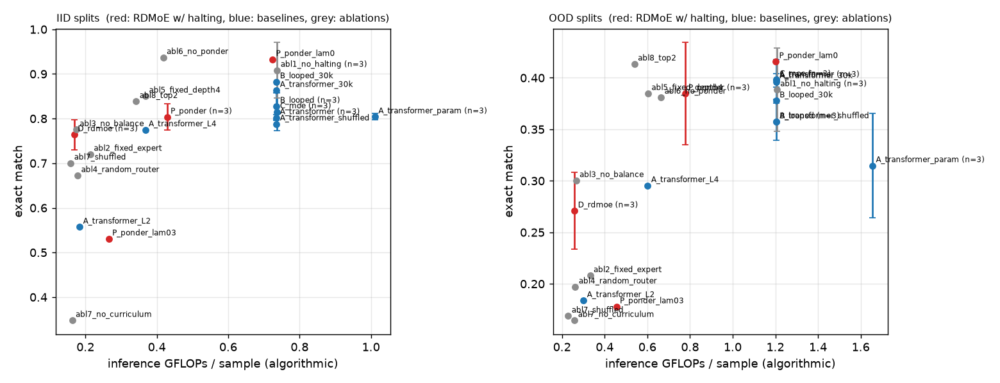
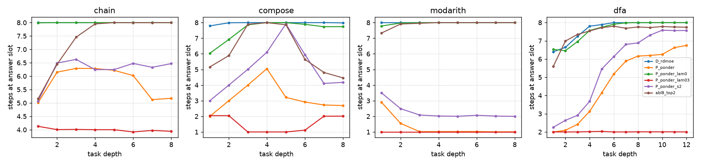

# RDMoE: initial experiment report

**Question.** Does letting a recurrent controller build input-dependent expert
trajectories improve reasoning performance or compute efficiency over
fixed-depth Transformer and MoE baselines?

**Short answer, on these synthetic tasks at ~35M parameters:**

| Claim | Status |
|---|---|
| Recurrent core + routed expert pool beats the baselines in-distribution | **Partly supported.** Without halting, it breaks the `compose`/`modarith` plateau in 2 of 3 seeds. None of the 6 dense-baseline runs did (A and B, 3 seeds each), nor did 1 run of each at 3× the training steps. The variance across seeds is large. |
| It generalizes better out of distribution (deeper, longer, unseen compositions) | **Not supported on deeper or longer inputs.** OOD exact match ties A (0.388 vs 0.398). Exception: unseen function compositions (`compose/ood_comp`) are solved whenever `compose` itself is. |
| Adaptive halting saves compute without hurting accuracy | **ACT: no.** It saves 77% of FLOPs but costs 0.14 iid and 0.12 OOD exact match against no halting. **PonderNet: yes, with caveats.** It matches A's accuracy at 58% of A's FLOPs, and depth genuinely tracks difficulty. But it is sensitive to the penalty weight and has a "give-up" failure mode. |
| It uses more computation on harder examples | **Yes, with PonderNet.** On `compose` it uses depth + 1 steps; on `dfa` the step count rises from 2 to 6 with depth. ACT does not do this at the answer slots. |
| Its lower FLOPs translate into wall-clock savings | **No.** Every routed model is slower than a dense Transformer. One MoE layer costs 6.7× a dense FFN of equal FLOPs. |

Everything here is a first milestone: single node, 10k steps, 1–3 seeds per configuration.
Do not read these numbers as general claims about the architecture.

## 1. Setup

- **Models** (d=512, 8 heads, d_ff=2048, max 8 steps or layers, RoPE, BF16):
  - A: Transformer, 8 layers, 25.3M params.
  - A′: Transformer, 11 layers, 34.8M params (parameter-matched to D).
  - B: looped Transformer, 1 block × 8, 3.3M params.
  - C: layer-wise MoE, 8 layers × 2 experts, top-1, 42.1M params.
  - D: RDMoE, shared attention + 16 experts, top-1, ACT, 34.8M params.
  - P: D with PonderNet halting.
- **Matching:** A, B and C match D's FLOPs at maximum depth. A′ and D have the same parameter count.
- **Data:** six procedural task families (README §Tasks). Training uses a 4-stage curriculum.
  Evaluation uses 1000 examples per (task, split) on fixed seeds, covering iid, `ood_depth`, `ood_len` and `ood_comp`.
- **Training:** 10k steps, global batch 256, AdamW at 3e-4 with cosine decay, clip 1.0.
  Losses: `L_task + λ·E[T] + α·L_balance` with λ = 0.005 (ACT) or 0.01 (PonderNet) and α = 0.01.
- **Compute and runs:** 2× H100 NVL. Runs went three per GPU in parallel; DDP works but gives no speedup at this size.
  Latency and throughput were re-measured afterwards on an idle GPU (warm, medians).
- **Reproduce:** `./run_experiments.sh && .venv/bin/python -m rdmoe.report runs`.
  Full per-run tables are in [results/report.md](results/report.md).

## 2. Main result: accuracy vs. inference compute

Values are mean ± std over seeds where n = 3. "EM" is exact match. "GFLOPs" are algorithmic, counted only for tokens still running.

| Model | n | Params | iid EM | OOD EM | GFLOPs / sample | Steps / answer slot | Latency bs1 | Throughput (bs512) |
|---|---:|---:|---:|---:|---:|---:|---:|---:|
| A Transformer 8L | 3 | 25.3M | 0.802 ± 0.006 | **0.398 ± 0.006** | 0.74 | 8 | 5.7 ms | 35.0k/s |
| A′ Transformer 11L (param-matched) | 3 | 34.8M | 0.804 ± 0.007 | 0.315 ± 0.051 | 1.01 | 11 | 7.7 ms | 28.9k/s |
| B Looped 1×8 | 3 | 3.3M | 0.828 ± 0.029 | 0.357 ± 0.018 | 0.74 | 8 | 5.4 ms | 35.1k/s |
| C MoE 8L×2E | 3 | 42.1M | 0.815 ± 0.042 | **0.398 ± 0.019** | 0.74 | 8 | 10.0 ms | 27.1k/s |
| **D RDMoE + ACT** | 3 | 34.8M | 0.764 ± 0.034 | 0.271 ± 0.037 | **0.17** | 7.8 | 11.7 ms | 20.4k/s |
| **P RDMoE + PonderNet** | 3 | 34.8M | 0.803 ± 0.029 | 0.385 ± 0.050 | 0.43 | **4.4** | 7.8 ms | 20.0k/s |
| RDMoE, no halting (abl1) | 3 | 34.8M | **0.908 ± 0.062** | 0.388 ± 0.041 | 0.74 | 8 | 11.1 ms | 22.0k/s |
| A Transformer 2L (compute-matched to D) | 1 | 6.4M | 0.557 | 0.184 | 0.18 | 2 | 1.8 ms | 62.0k/s |
| A Transformer 4L | 1 | 12.7M | 0.775 | 0.295 | 0.37 | 4 | 3.1 ms | 49.2k/s |
| A, 30k steps | 1 | 25.3M | 0.863 | 0.396 | 0.74 | 8 | 5.7 ms | 35.1k/s |
| B, 30k steps | 1 | 3.3M | 0.882 | 0.378 | 0.74 | 8 | 5.4 ms | 35.0k/s |

**Reading:**

- **At equal FLOPs (0.74 GFLOPs),** routing experts inside a recurrent core (abl1) gives the best iid accuracy.
  The gap is entirely `compose` and `modarith`; see §3.
  OOD is a tie with A and C.
- **At matched parameters,** A′ gains nothing from 3 extra layers, so abl1's advantage is not just parameter count.
- **At equal algorithmic compute (≈0.18 GFLOPs),** D beats a 2-layer Transformer by a wide margin: 0.76 vs 0.56 iid and 0.27 vs 0.18 OOD.
  That comparison flatters D, though. D has 5× the parameters, it gives answer slots 8 steps while giving context tokens about 1.8, and it is 6.5× slower at batch size 1.
- **PonderNet sits on the Pareto front among the routed models.** It matches A's accuracy at 58% of A's FLOPs.
  It is the only model whose latency at batch size 1 benefits from adaptive depth: 7.8 ms vs 11.1 ms without halting.
  It is still slower than A (5.7 ms).

## 3. Where the iid gap comes from: an optimization plateau

Every model learns `assoc`, `attr` and `dfa`. `compose` and `modarith` plateau at roughly 0.57–0.66 and 0.40 for most runs.
The fraction of runs that escape the plateau (`compose` iid ≥ 0.95):

| Model | Runs escaping |
|---|---|
| A (8L, 11L, 30k steps) | 0 / 7 |
| B (incl. 30k steps) | 0 / 4 |
| C | 0 / 3 (best 0.89) |
| D (ACT) | 1 / 3 |
| P (PonderNet) | 2 / 3 |
| RDMoE without halting | 2 / 3 |
| Single seeds: no ponder penalty, PonderNet with λ=0 | 2 / 2 |

The baselines' plateau does not lift with 3× more training: A's `compose` creeps from 0.65 to 0.76 over 30k steps.
When a routed recurrent model escapes, it reaches 1.00 on `compose`, and also 1.00 on `compose/ood_comp`.
`ood_comp` contains adjacent function pairs never seen in training, so the model has learned composition itself, not memorized pairs.
It still fails on longer chains (`ood_depth` ≤ 0.18), so it does not learn to iterate beyond the trained depth.

The effect is real, but it is a probability of escaping the plateau, not a guaranteed gain. Three seeds cannot pin that probability down.

## 4. Adaptive computation

**ACT (Graves) never shortens the answer slots.**
- 83–94% of answer slots run all 8 steps, depending on the seed.
- The saving comes almost entirely from context tokens, which drop to about 1.8 steps.
- Three structural reasons:
  1. The ponder cost is averaged over all tokens, and answer slots are about 1/17 of them.
  2. The step count N has no gradient, so ACT never learns that stopping at step 3 would have been just as good.
  3. ACT outputs a weighted blend of states, so halting early mixes in unfinished states.

**An oracle shows the room for improvement** (`rdmoe/oracle_depth.py`).
Apply the output head after every step and record the earliest step from which the answer is correct and stays correct.
The required depth grows with task depth even in models trained without halting. Examples:
- `compose` needs 3 → 6 steps for depths 1 → 4.
- `dfa` needs 1 → 3 steps.

The right depth is therefore present in the learned solutions.

**PonderNet** implementation:
- Halting is decided at the answer slots, and each sample runs until all its answer slots halt.
- Training uses the exact expected loss over all 8 steps, Σₜ pₜ·CEₜ, so no sampling is needed.
- At inference it stops at the median of the halting distribution.
- A unit test checks that early-exit predictions are identical to the training-time per-step predictions.

PonderNet results:

- **`compose`: 2, 3, 4, 5 steps for depths 1–4, at 100% accuracy.** That tracks the oracle (2, 3, 4, 4).
- **`dfa`:** 2.0 → 6.2 steps as depth grows from 1 to 8. Spearman correlation between depth and steps is +0.8.
- **Give-up failure mode on `modarith`.** That task was not yet learned beyond depth 1, so the halting head learns that extra steps don't lower the loss and stops after 1 step (Spearman −0.77). That likely starves the task of the depth it needs to learn: with λ = 0, `modarith` reaches 1.00. A penalty warm-up or forced exploration (as in HRM's ε-greedy halting) are the obvious fixes; neither has been tested.
- **The penalty weight is a sharp knob:**

  | λ | iid EM | GFLOPs |
  |---|---:|---:|
  | 0 | 0.93 | 0.72 |
  | 0.01 | 0.80 | 0.43 |
  | 0.03 | 0.53 | 0.27 |

- **Step counts do not extrapolate.** On deeper-than-trained `compose`, the halting head stops early (about 3 steps for depth 5).

## 5. Ablations (seed 0; reference is D at 0.742 iid / 0.233 OOD)

| # | Ablation | iid EM | OOD EM | GFLOPs | Takeaway |
|---|---|---:|---:|---:|---|
| 1 | No adaptive halting (8 steps) | 0.970 | 0.395 | 0.74 | ACT is the component that hurts most |
| 2 | Fixed expert (= looped + ACT) | 0.720 | 0.208 | 0.21 | Routing beats no routing, modestly |
| 3 | No load balancing | 0.775 | 0.300 | 0.17 | Balance loss not needed: 12 of 16 experts stay in use without it |
| 4 | Random routing | 0.672 | 0.197 | 0.18 | Learned routing > random: trajectories carry information |
| 5 | Fixed depth 4, no halting | 0.850 | 0.385 | 0.37 | Matches A at half the FLOPs, at A's speed (5.9 ms, 34k/s) |
| 6 | No computation penalty | 0.937 | 0.381 | 0.42 | ACT without the penalty still halts context tokens and is far better |
| 7a | Curriculum → shuffled (same data multiset) | 0.700 | 0.169 | 0.16 | Curriculum helps D |
| 7b | Curriculum → none (final mixture only) | 0.348 | 0.164 | 0.16 | Without staging, D never learns `assoc` |
| 7c | Curriculum → shuffled, Transformer A | 0.788 | 0.357 | 0.74 | Much smaller effect for A: −0.014 iid |
| 8 | Top-2 routing | 0.838 | 0.413 | 0.34 | Better than top-1 at 2× expert FLOPs |

Ablation 5 deserves a multi-seed follow-up. A fixed-depth RDMoE gets most of the benefit with no halting machinery, at a dense model's speed.

## 6. Routing behaviour (D, 3 seeds)

- **Expert usage is near-uniform.** All 16 experts are used, with usage entropy 2.61–2.74 out of a maximum of 2.77.
- **Experts are revisited.** On an answer-slot trajectory, 57–62% of steps reuse an expert already used earlier on that path.
- **Trajectories are highly input-dependent.** There are about 2,800 distinct answer-slot trajectories among 6,000 iid examples.
- **New trajectories appear OOD but don't help.** 50–57% of OOD trajectories never occur in iid data, yet OOD accuracy is low. Producing a novel trajectory is not the same as generalizing.
- **PonderNet compresses its trajectories.** It uses far fewer distinct ones (300–1,000), so trajectories become more reusable once depth is adaptive.
- **The conventional MoE splits evenly.** C's two experts per layer split exactly 50/50.

## 7. Hardware efficiency

From [results/profile_overhead.txt](results/profile_overhead.txt):

| Measurement | Dense | MoE |
|---|---|---|
| One FFN layer, fwd+bwd, 9k tokens, equal FLOPs | 0.69 ms | 4.6 ms top-1 ×16 (6.7×) |
| Full training step, batch 256 | A: 14.5 ms | D: 38.2 ms (2.6×) |

D's training step is 2.6× A's despite D running fewer loop iterations.

The causes are all overhead, not arithmetic:
- per-expert small GEMMs;
- one host sync per step for the dispatch split sizes, plus one for the halting check;
- shape-dependent kernel selection. Cold throughput is up to 2× lower than warm until the kernel caches are populated.

The fixes are grouped GEMMs, capacity-bucketed dispatch, and sync-free halting (as in Mixture-of-Recursions). Until those are in, any FLOP saving here is theoretical.

## 8. A pitfall worth recording: positional encoding

The first matrix used additive sinusoidal positions ([results/sinusoidal_pilot](results/sinusoidal_pilot/summary.txt)).
Every model stuck at chance on in-context key→value recall:
- A reached 0.06 on `assoc` even when trained on `assoc` alone at two learning rates.
- Training loss sat near ln(6), meaning the model guessed uniformly among the values in context.

Switching to RoPE solved `assoc` in about 2.5k steps.
All results above use RoPE. Without this fix the comparison would have measured that plateau, not the architectures.

## 9. Threats to validity

- **Seeds:** 1–3 per configuration. The plateau-escape effect in §3 is stochastic.
- **Scale:** synthetic tasks only, 35M parameters, 10k steps. Nothing here says anything about language modeling.
- **Matching:** baselines match FLOPs or parameters, not both (README §Matching). B has 10× fewer parameters.
- **Per-architecture tuning:** hyperparameters were not tuned per architecture. ACT and PonderNet penalty weights were set once; only PonderNet's λ was swept, at three values.
- **What the FLOP counts cover:** they are analytic and exclude embeddings and the output head. Wall-clock numbers come from one GPU type.

## 10. Recommended next steps (in priority order)

1. **More seeds** (≥5) for abl1, ablation 5, P and A, to estimate plateau-escape probabilities properly.
2. **Fix PonderNet's give-up mode** with a penalty warm-up (λ = 0 for the first half of training) or ε-greedy forced continuation. Then sweep λ for a full accuracy–compute curve.
3. **Efficient dispatch:** grouped GEMMs and sync-free halting. Without these there is no wall-clock story.
4. **A public benchmark** (small-scale LM, CFQ or similar) to compare against MoEUT, SUT and MoR on their own terms.
5. **Hold the diffusion trajectory planner (§10 of the brief).** Direct routing works, but halting, not trajectory choice, is the current bottleneck. Random routing is only 0.07 worse than learned routing. A trajectory teacher has little to add until that changes.
